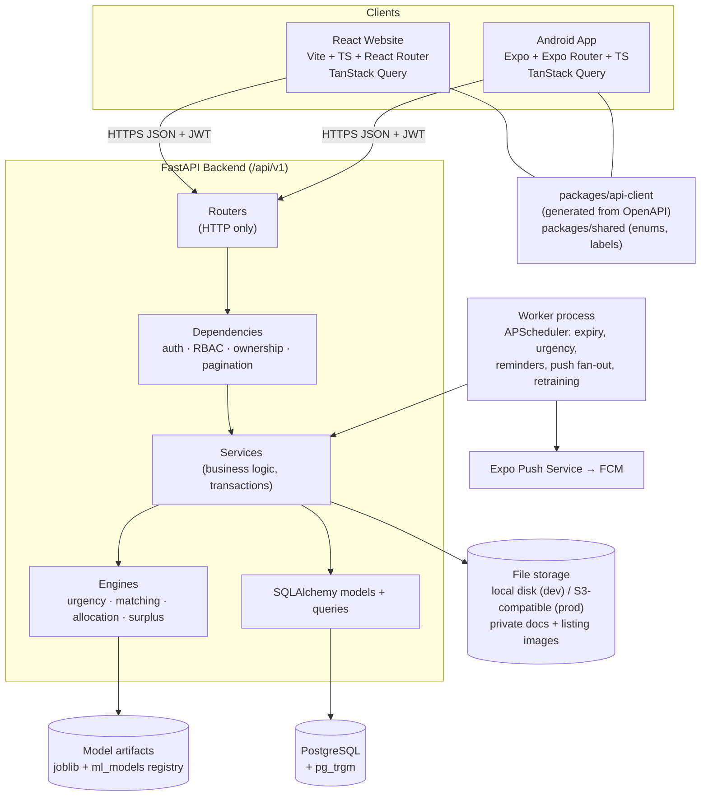
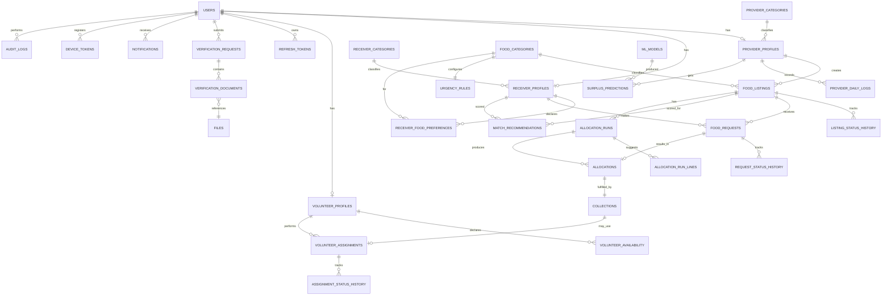
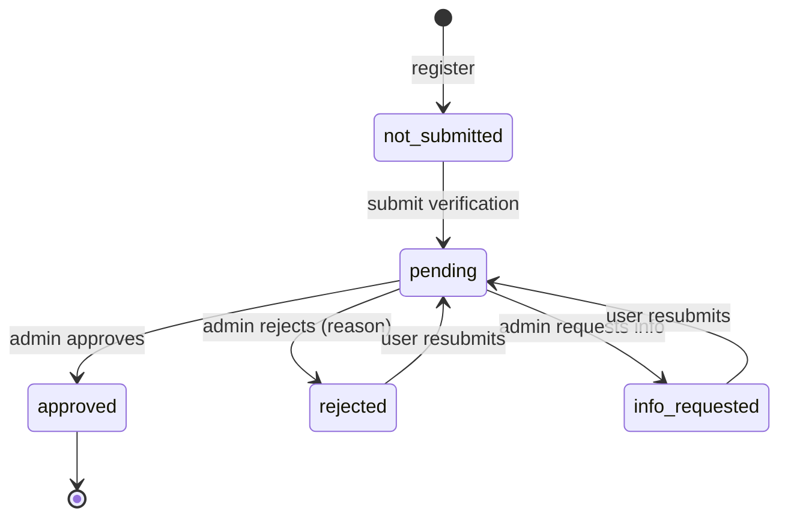

# FreshLink — Technical Plan (Pre-Implementation)

**Project:** FreshLink — AI-driven, date-aware food surplus allocation and redistribution system
**Platforms:** React website + React Native (Expo) Android app
**Shared:** FastAPI backend · PostgreSQL · one auth system · one business-logic layer
**Team:** 3 members
**Status:** Plan for review. No code written yet.

---

## Contents

1. Review findings: technical issues and unrealistic features
2. System architecture
3. Database design and relationships
4. API endpoint catalogue
5. Authentication and role-based authorization
6. Website and mobile feature breakdown (parity matrix)
7. AI/ML implementation plan
8. Project folder structure
9. Development phases
10. Testing strategy
11. Division of work (team of three)
12. Decisions needed before coding

---

## 1. Review Findings: Technical Issues and Unrealistic Features

The specification is solid and unusually careful about food safety and honest ML claims. The points below are the gaps, contradictions and risks I found. Each one has a recommended resolution, and the rest of this plan already uses those resolutions.

### 1.1 High-impact issues (must resolve)

| # | Issue | Why it matters | Resolution in this plan |
|---|---|---|---|
| H1 | **Quantities in mixed units are summed in reports.** "Total food quantity listed" adds kg, pieces, packages and portions together. | 20 kg rice + 30 buns ≠ 50 of anything. Examiners will catch it. | Every quantity carries a `unit`. Reports group by unit **and** show an *estimated meals* figure using admin-set conversion factors per category/unit, clearly labelled "estimate". |
| H2 | **Receiver "capacity" is one number,** but food comes in different units and categories. | You can't compare "capacity 50" against "30 packages of bread" and "12 kg rice". | Capacity is stored per food category: `receiver_food_preferences(category, max_quantity_per_pickup, unit)`. Matching and allocation use these numbers. |
| H3 | **Surplus estimation has no real training data.** Providers won't have historical sales when they sign up. | A regression model trained only on synthetic data proves nothing about the real world (the spec says so itself). | (a) A **Provider Daily Log** feature (produced / sold / surplus per day) so real data builds up as the system is used. (b) A synthetic data generator for development. (c) Always report results against a **naive baseline**. (d) A cold-start fallback for providers with fewer than 14 logs. |
| H4 | **Precision@K for matching needs ground truth,** and none exists. | Without labels the metric can't be computed. | Build a **hand-labelled evaluation set**: about 25 listings × candidate receivers, labelled relevant / not relevant by the team plus the supervisor. Use logged outcomes (requested / completed) as weak labels later. |
| H5 | **Concurrent quantity updates.** Two providers' devices, or provider + admin, can confirm allocations at the same time. A provider can also lower the quantity after allocations exist. | Over-allocation corrupts data, and the spec explicitly requires protection against this. | Row lock (`SELECT … FOR UPDATE`) on the listing inside the confirm transaction, DB `CHECK (allocated_quantity <= total_quantity)`, an optimistic `version` column on listing edits, and `Idempotency-Key` on POSTs from mobile. |
| H6 | **"Matching" and "requests" overlap conceptually.** The spec has receivers requesting food *and* the system recommending receivers. | Without a clear role, matching becomes decoration. | Matching does three concrete jobs: (1) **notify the top-K matched receivers** when a listing is published ("New relevant listing"); (2) a **"Recommended for you"** feed for receivers; (3) **ranking and annotating incoming requests** for the provider. Allocation then splits quantity among the requests. |
| H7 | **Full parity, including the complete admin dashboard on mobile, roughly doubles frontend work.** About 45 web pages need about 45 mobile equivalents. | This is the main schedule risk for a 3-person team. | A shared TypeScript API client and query hooks (one package, generated from OpenAPI) used by both apps. A shared status/label/enum package. A strict scope freeze after Phase 3. Mobile starts on a stable API. |
| H8 | **Spec rule 20 (build web + backend first, then mobile) leaves Member 3 idle early,** then overloaded later with mobile + AI. | Uneven load and late risk. | Member 3 does the ML work **first** (weeks 3–12, when the mobile app can't start anyway), then mobile. See §11. |

### 1.2 Medium issues (design decisions needed)

| # | Issue | Resolution |
|---|---|---|
| M1 | **Push notifications in Expo Go.** Recent Expo SDKs no longer support remote push in Expo Go on Android, so you need a **development build** (EAS Build) plus a Firebase (FCM) project. | In-app notifications first (required), using polling of the unread count. Expo push comes in Phase 5 with a dev build. Never rely on Expo Go for the demo. |
| M2 | **"Synchronization" can be read as real-time.** | Define it as *near-real-time*: both apps use TanStack Query with refetch-on-focus, invalidation after mutations, and 30 s polling on dashboards and notifications. Optional upgrade: Server-Sent Events for notifications. No offline writes, because quantity conflicts make offline editing unsafe (the spec already assumes connectivity). |
| M3 | **Maps.** `react-native-maps` on Android needs a Google Maps API key. The OpenStreetMap tile and Nominatim geocoding policies forbid heavy use (Nominatim allows about 1 request/second). | Distance is computed **server-side with the Haversine formula** (no API needed). Web uses Leaflet + OSM tiles for display. Mobile shows a simple map preview and an "Open in Maps" deep link for directions. Location comes from a pin-drop or device GPS, with geocoding only as a convenience. |
| M4 | **Android blocks plain HTTP** in release builds, and the phone can't reach `localhost`. | Development uses the LAN IP via `EXPO_PUBLIC_API_URL`. The demo uses a deployed **HTTPS** backend. |
| M5 | **"Other administrator-approved arrangement"** for distribution type is undefined, and payments are out of scope. | v1 supports `free_donation` only. The enum keeps a placeholder value that admins can't enable until it's defined. |
| M6 | **Small food businesses as receivers.** Donated food could be resold. | Admin-controlled per receiver category: `allow_small_business_receivers` setting, a mandatory "not for resale" declaration, and a lower default allocation priority. Flag it in the report as a policy question. |
| M7 | **Individual/household verification.** National ID images are highly sensitive, and the spec rules out government database integration. | Verification is manual document review by an admin only. Documents are stored privately (never public URLs), served through an authorized endpoint, and deleted or retained per a retention setting. Collect the minimum data needed. |
| M8 | **Background jobs** (auto-expire listings, urgency recompute, reminders). Running a scheduler inside Uvicorn with several workers runs every job several times. | A separate `worker` process (APScheduler) with one instance. Jobs are idempotent. Urgency is also computed live on read, so the job only drives state changes and notifications. |
| M9 | **Duplicated fields in the spec schema:** `verification_status` appears on users *and* each profile; `approved_quantity` appears on requests *and* allocations; collection records require an assignment, but direct pickup has none. | Single source of truth for each field (see §3.4). |
| M10 | **OR-Tools may be overkill.** With only "total ≤ available" and per-receiver caps, a weighted greedy algorithm is *provably optimal* (it is the fractional knapsack problem). | Use a greedy algorithm for the base policy and **CP-SAT** only where it is actually needed: minimum useful quantity per receiver, integer units, and max-min fairness. Test that the solver equals greedy on the base case. This is a strong viva point. |
| M11 | **Time zones.** Urgency depends entirely on correct time arithmetic. | Store all times as `timestamptz` (UTC). Display in Asia/Karachi. Unit-test the date logic, including boundary cases. |
| M12 | **PDF export.** WeasyPrint has heavy system dependencies. | Generate CSV server-side for everything, and PDF with ReportLab for summary reports. Both apps download from the same endpoint (mobile uses `expo-file-system` + `expo-sharing`). |

### 1.3 Food-safety wording (non-negotiable)

- The UI shows **urgency and date facts only**, for example "High urgency — collection deadline in 3 h 20 m". It never shows "safe", "fresh", "edible" or a quality score.
- Missing date information produces an **"Incomplete date info"** badge, not a "Normal" level.
- Providers must tick a **declaration** before publishing ("I confirm the information is accurate and the food has been handled according to applicable standards").
- Per-category urgency thresholds are **admin-configured platform rules for prioritization**. The seeded values are demo placeholders, not safety limits, and the UI says so.
- The project title says "Shelf-Life-Aware". In the report and viva, describe this as *date-aware prioritization based on provider-supplied dates*.

### 1.4 Honest labelling of the "AI" modules (for the report and viva)

| Module | What it actually is | Label to use |
|---|---|---|
| Surplus estimation | Supervised regression (scikit-learn) | **Machine learning** |
| Receiver matching | Explainable weighted scoring (v1) → learned ranker with logistic regression / gradient boosting (v2) | **Heuristic + ML ranking** |
| Allocation | Constrained optimization (greedy / CP-SAT) | **Optimization / operations research** |
| Urgency | Configurable rule engine over dates | **Rule-based decision support** (not ML) |

Labelling these honestly makes the project stronger, not weaker.

### 1.5 Explicitly out of scope (confirm with your supervisor)

Live GPS tracking of volunteers (status updates only), multi-stop route optimization, payments, an iOS build, offline mode, Urdu localisation (the i18n structure is prepared but not translated).

---

## 2. System Architecture

### 2.1 High-level view



### 2.2 Architecture rules (from the spec, made concrete)

1. **One backend, one database.** Both apps call identical endpoints. There are no platform-specific endpoints except token transport (§5).
2. **Layering:** routers only parse and validate HTTP; services own transactions and business rules; engines are pure Python functions (no DB access) so they are unit-testable and explainable.
3. **All authorization runs on the server**: role checks + ownership checks + field-level privacy. The frontends only hide UI elements.
4. **State machines** for listing, request, allocation, collection and assignment statuses live in one module (`app/domain/state_machines.py`). Any illegal transition returns `409 Conflict`.
5. **API contract first:** FastAPI generates OpenAPI → `openapi-typescript` generates TS types → both apps share one typed client. CI fails if the generated client is out of date.

### 2.3 Request lifecycle example (allocation confirm)

```mermaid
sequenceDiagram
    participant P as Provider (web or app)
    participant A as FastAPI
    participant DB as PostgreSQL
    participant W as Worker
    P->>A: POST /listings/{id}/allocation-runs {policy}
    A->>DB: read listing, open requests, receiver prefs, urgency rules
    A->>A: allocation engine → suggested lines + explanations
    A->>DB: insert allocation_run (draft) + lines
    A-->>P: suggestion
    P->>A: POST /allocation-runs/{run}/confirm {lines, override_reasons}
    A->>DB: BEGIN; SELECT listing FOR UPDATE
    A->>A: re-validate (remaining qty, eligibility, run not stale)
    A->>DB: insert allocations, update requests, allocated_quantity, history, audit
    A->>DB: insert notifications; COMMIT
    A-->>P: 200 confirmed
    W->>DB: poll undelivered push notifications
    W-->>P: push to receivers' devices
```

### 2.4 Synchronization strategy

| Mechanism | Where |
|---|---|
| Single source of truth (PostgreSQL via API) | Everything |
| Query invalidation after each mutation | Both apps (TanStack Query) |
| Refetch on window focus / app foreground | Both apps |
| 30 s polling of `/notifications/unread-count` and dashboard summaries | Both apps |
| Optimistic concurrency (`version` + `If-Match`) | Listing edits, assignment status |
| `409` with the current state on stale updates; the UI refreshes and explains | Both apps |
| Optional: SSE `/events` stream | Phase 5 stretch goal |

### 2.5 Technology choices

| Layer | Choice | Reason |
|---|---|---|
| Backend | Python 3.12, FastAPI, Pydantic v2, SQLAlchemy 2.0, Alembic, Uvicorn | Spec stack |
| Auth | PyJWT, `pwdlib` with Argon2 | Maintained; current FastAPI docs use pwdlib |
| Rate limiting | `slowapi` on auth endpoints | Brute-force protection |
| Jobs | APScheduler in a separate worker process | Simple, single instance |
| ML | pandas, NumPy, scikit-learn, OR-Tools (CP-SAT), joblib | Spec stack |
| Website | React 18 + Vite + TypeScript, React Router, TanStack Query, react-hook-form + zod, MUI (or Tailwind + shadcn/ui), Recharts, react-leaflet | Mature and fast to build |
| Mobile | Expo (latest SDK), Expo Router, TanStack Query, react-hook-form + zod, React Native Paper, expo-secure-store, expo-image-picker, expo-location, expo-notifications, expo-file-system, expo-sharing, react-native-gifted-charts | Expo-supported libraries only, so builds stay simple |
| Monorepo | pnpm workspaces | Share the API client and enums |
| Infra | Docker Compose (Postgres + API + worker) for development; Render/Railway/VPS + managed Postgres for the demo; EAS Build → APK | Reproducible setup |

---

## 3. Database Design and Relationships

### 3.1 Conventions

- Primary keys: `UUID` (`gen_random_uuid()`). This prevents ID enumeration in URLs.
- All times are `timestamptz`; `created_at` and `updated_at` on every table.
- Quantities are `NUMERIC(10,2)`. Countable units (piece, package, portion, tray) are validated as integers in the service layer.
- Status enums are stored as `VARCHAR` + `CHECK` (SQLAlchemy `Enum(native_enum=False)`) so migrations stay easy.
- Soft delete (`deleted_at`) for users and listings. History is never hard-deleted.
- Extensions: `pgcrypto`, `pg_trgm` (fuzzy food-name search), `citext` (case-insensitive email).

### 3.2 Entity-relationship diagram



### 3.3 Table definitions

**Identity and access**

| Table | Key columns | Constraints and notes |
|---|---|---|
| `users` | id, email (citext), phone, full_name, password_hash, role (`provider/receiver/volunteer/admin`), account_status (`active/deactivated/suspended`), verification_status (`not_submitted/pending/info_requested/approved/rejected`), is_super_admin, token_version, last_login_at, deleted_at | `UNIQUE(email)`, `UNIQUE(phone)`. Admins are created only by CLI or a super admin. **Single source** of verification status. |
| `refresh_tokens` | id, user_id, token_hash, platform (`web/mobile`), device_label, expires_at, revoked_at, replaced_by_id | Rotation + reuse detection: reusing a revoked token revokes the whole token family. |
| `device_tokens` | id, user_id, expo_push_token, last_seen_at | `UNIQUE(expo_push_token)` |
| `idempotency_keys` | key, user_id, method_path, response_status, response_body, created_at | `PK(key, user_id)`; purged after 24 h |

**Profiles**

| Table | Key columns | Notes |
|---|---|---|
| `provider_profiles` | id, user_id (unique), business_name, provider_category_id, address, latitude, longitude, contact_person, contact_phone, opening_hours (jsonb) | Approval status lives on `users`, not duplicated here |
| `receiver_profiles` | id, user_id (unique), receiver_name, receiver_category_id, address, latitude, longitude, max_pickup_radius_km, has_own_transport, household_size (individuals), is_eligible, eligibility_notes, not_for_resale_declared | Address/contact shown to others only within an authorized transaction |
| `receiver_food_preferences` | receiver_id, food_category_id, max_quantity_per_pickup, unit | `PK(receiver_id, food_category_id)`. **This is "capacity"** (fixes H2) |
| `volunteer_profiles` | id, user_id (unique), address, latitude, longitude, has_vehicle, vehicle_type, service_radius_km, is_available_now | |
| `volunteer_availability` | id, volunteer_id, day_of_week (0–6), start_time, end_time | `CHECK(end_time > start_time)` |

**Configuration (admin-managed)**

| Table | Key columns | Notes |
|---|---|---|
| `provider_categories` | id, name, description, is_active | Bakery, Restaurant, Fast-food, Grocery/Supermarket |
| `receiver_categories` | id, name, description, priority_weight, requires_documents, is_active | NGO, Community kitchen, Small business, Community group, Individual/household |
| `food_categories` | id, name, description, perishability_class (`cooked/bakery/fresh_produce/dairy/packaged/other`), requires_preparation_time, requires_expiry_date, meals_per_unit (jsonb by unit, for the estimated-meals metric), is_active | Different date rules per category, as the spec requires |
| `urgency_rules` | id, food_category_id (unique), medium_hours, high_hours, critical_hours, max_hours_since_preparation (nullable), updated_by | `CHECK(critical < high < medium)` |
| `verification_requirements` | id, role, receiver_category_id (nullable), document_type, is_required, description | Drives the registration form on both apps |
| `notification_categories` | code (PK), name, is_enabled, default_push | |
| `platform_settings` | key (PK), value (jsonb), updated_by | Search radius, request expiry, default allocation policy, matching weights, min allocation, `allow_small_business_receivers`, document retention days |

**Verification and files**

| Table | Key columns | Notes |
|---|---|---|
| `files` | id, owner_user_id, purpose (`listing_image/verification_doc/avatar`), storage_key, mime_type, size_bytes, is_private | Private files are served only through `GET /files/{id}` with an authorization check |
| `verification_requests` | id, user_id, status, submitted_at, reviewed_by, review_notes, reviewed_at | History of every submission and review (spec's *verification_records*) |
| `verification_documents` | id, verification_request_id, file_id, document_type | |

**Listings and requests**

| Table | Key columns | Constraints and notes |
|---|---|---|
| `food_listings` | id, provider_id, food_category_id, food_name, description, unit, total_quantity, allocated_quantity, preparation_at, packaging_at, best_before_at, expiry_at, pickup_window_start, pickup_window_end, collection_deadline, pickup_address, pickup_lat, pickup_lng, storage_info, distribution_type, image_file_id, status (`active/paused/fully_allocated/closed/expired/suspended/removed`), urgency_level (`normal/medium/high/critical/incomplete`), urgency_computed_at, declaration_accepted, version | `CHECK(total_quantity > 0)`, `CHECK(allocated_quantity BETWEEN 0 AND total_quantity)`, `CHECK(pickup_window_end > pickup_window_start)`, `CHECK(collection_deadline >= pickup_window_start)`. Indexes: `(status, collection_deadline)`, `(food_category_id)`, `(provider_id)`, GIN trigram on `food_name`. `remaining = total − allocated` is computed, never stored. |
| `listing_status_history` | id, listing_id, from_status, to_status, changed_by, reason, created_at | FR25 |
| `food_requests` | id, listing_id, receiver_id, requested_quantity, purpose, collection_preference (`self_pickup/needs_volunteer`), preferred_pickup_at, status (`pending/approved/partially_approved/rejected/cancelled/expired/completed`), rejection_reason, responded_at | `CHECK(requested_quantity > 0)`. **Partial unique index** `(listing_id, receiver_id) WHERE status IN ('pending','approved','partially_approved')` prevents duplicate requests |
| `request_status_history` | id, request_id, from_status, to_status, changed_by, reason, created_at | |

**Matching and allocation**

| Table | Key columns | Notes |
|---|---|---|
| `match_recommendations` | id, listing_id, receiver_id, score, rank, components (jsonb), reasons (jsonb), model_version, generated_at, notified_at, outcome (`none/viewed/requested/completed`) | Explanations shown in the UI. Outcomes become training labels for the ML ranker |
| `allocation_runs` | id, listing_id, policy (`priority_weighted/proportional_fair/first_come`), solver (`greedy/cp_sat`), available_snapshot, input_snapshot (jsonb), status (`draft/confirmed/discarded/superseded`), created_by, confirmed_by, confirmed_at | Full reproducibility of every recommendation |
| `allocation_run_lines` | id, run_id, request_id, suggested_quantity, explanation | |
| `allocations` | id, run_id, listing_id, request_id (unique), receiver_id, suggested_quantity, approved_quantity, status (`confirmed/in_collection/collected/completed/failed/cancelled`), decision_reason, override_reason, confirmed_by | `CHECK(approved_quantity > 0)`. `override_reason` is required when approved ≠ suggested (enforced in the service + audited) |

**Collection and volunteers**

| Table | Key columns | Notes |
|---|---|---|
| `collections` | id, allocation_id (unique), method (`self_pickup/volunteer`), scheduled_pickup_at, handed_over_quantity, handed_over_at, received_quantity, received_at, status (`scheduled/handed_over/received/failed/cancelled`) | Works for **direct pickup with no volunteer** (fixes M9). `CHECK(received_quantity <= handed_over_quantity)` |
| `volunteer_assignments` | id, collection_id, volunteer_id (nullable = open for claim), assigned_by, pickup snapshot (address/lat/lng), dropoff snapshot, scheduled_pickup_at, status (`open/assigned/accepted/declined/en_route_pickup/collected/en_route_dropoff/delivered/completed/failed/cancelled`), decline_reason, version | Partial unique index: one active assignment per collection |
| `assignment_status_history` | id, assignment_id, from_status, to_status, changed_by, note, created_at | |
| `issue_reports` | id, reporter_id, entity_type (`listing/request/collection/assignment`), entity_id, category, description, status (`open/in_review/resolved`), resolved_by, resolution_note | Shared by "report a problem" for all roles |

**Notifications, audit, ML**

| Table | Key columns | Notes |
|---|---|---|
| `notifications` | id, user_id, category_code, title, body, entity_type, entity_id, is_read, read_at, push_status | Index `(user_id, is_read, created_at DESC)`. `entity_*` enables deep links in both apps |
| `announcements` | id, created_by, title, body, audience_type (`all/role/users`), audience_role | Fanned out into `notifications` |
| `audit_logs` | id, actor_id, actor_role, action, entity_type, entity_id, reason, before (jsonb), after (jsonb), ip, user_agent, created_at | Append-only; the app's DB role has no UPDATE/DELETE on it |
| `provider_daily_logs` | id, provider_id, log_date, food_category_id, unit, produced_qty, sold_qty, surplus_qty, source (`manual/import/synthetic`) | `UNIQUE(provider_id, log_date, food_category_id)`. Training data for surplus estimation |
| `surplus_predictions` | id, provider_id, food_category_id, target_date, predicted_qty, lower_qty, upper_qty, model_version, features (jsonb), actual_qty | `actual_qty` is backfilled from the daily log, which allows live accuracy tracking |
| `ml_models` | id, name (`surplus/matching`), version, algorithm, data_description, metrics (jsonb), artifact_path, trained_at, is_active | Model registry shown in the admin UI |

### 3.4 Corrections to the spec's schema

| Spec | Change | Reason |
|---|---|---|
| `verification_status` on users **and** on each profile; `approval_status` on providers | Keep only `users.verification_status` + the `verification_requests` history | Single source of truth |
| `food_requests.approved_quantity` **and** `allocations.approved_quantity` | Approved quantity lives only in `allocations`; the request holds the status | No drift between the two |
| `collection_records.assignment_id` required | `collections` belongs to the allocation; the assignment is optional | Direct pickup must work |
| `food_listings.available_quantity` | `total_quantity` + `allocated_quantity`, remaining computed | Safe concurrent updates |
| `receiver_profiles.capacity` (single number) | `receiver_food_preferences` per category + unit | H2 |
| `audit_logs.administrator_id` | `actor_id` + `actor_role` + before/after JSON | Some important actions are not admin actions (e.g. provider overrides) |
| Missing tables | provider/receiver categories, urgency rules, settings, refresh tokens, files, allocation runs, status histories, issue reports, device tokens, daily logs, model registry | Needed by the spec's own features (FR24, FR25, admin system management) |

### 3.5 Quantity accounting (what reports must distinguish)

```
listed      = food_listings.total_quantity
allocated   = SUM(allocations.approved_quantity  WHERE status <> 'cancelled')
handed over = SUM(collections.handed_over_quantity)
received    = SUM(collections.received_quantity)          ← "distributed"
unallocated = listed − allocated      (on closed/expired listings = not redistributed)
```

All of these are grouped **by unit**, with an optional *estimated meals* column.

---

## 4. API Endpoint Catalogue

### 4.1 Conventions

- Base path `/api/v1`. JSON only. ISO-8601 UTC timestamps.
- Lists return `{ "items": [...], "total": n, "page": p, "page_size": s }`, with filters as query parameters and sorting via `?sort=-created_at`.
- Errors return `{ "error": { "code": "LISTING_QUANTITY_EXCEEDED", "message": "…", "details": {...} } }`. Codes are stable, so both apps map them to the same friendly messages.
- `401` unauthenticated · `403` wrong role/ownership · `404` not found **or not visible to you** · `409` illegal state transition / stale version · `422` validation.
- Mutating POSTs from clients accept an `Idempotency-Key` header. Listing and assignment updates accept `If-Match: <version>`.
- **Scoping rule:** the same list endpoint returns different rows depending on the caller's role (e.g. `GET /requests`). Business logic stays in one place.

**Legend:** P = Provider · R = Receiver · V = Volunteer · A = Admin · ✓ = verified (approved) account required · Any = any authenticated user · Pub = public

### 4.2 Authentication

| Method | Path | Who | Purpose |
|---|---|---|---|
| POST | `/auth/register` | Pub | Register as provider/receiver/volunteer (the admin role is rejected) |
| POST | `/auth/login` | Pub | Email/phone + password → access token (+ refresh token, §5) |
| POST | `/auth/refresh` | Pub | Rotate refresh token |
| POST | `/auth/logout` | Any | Revoke the current refresh token |
| POST | `/auth/logout-all` | Any | Revoke all sessions |
| GET | `/auth/me` | Any | Current user, role, statuses, permissions |
| POST | `/auth/change-password` | Any | |
| POST | `/auth/forgot-password` · `/auth/reset-password` | Pub | Optional (needs email/SMS); stretch goal |

### 4.3 Profiles, verification, files, lookups

| Method | Path | Who | Purpose |
|---|---|---|---|
| GET / PUT | `/users/me` | Any | Common account fields |
| GET / PUT | `/providers/me` | P | Business profile, location |
| GET | `/providers/{id}` | Any✓ | Public business card (name, category, area) |
| GET / PUT | `/receivers/me` | R | Receiver profile |
| GET / PUT | `/receivers/me/food-preferences` | R | Categories + max quantity per pickup |
| GET / PUT | `/volunteers/me` | V | Volunteer profile |
| GET / PUT | `/volunteers/me/availability` | V | Weekly slots + available-now toggle |
| GET | `/me/dashboard` | Any | Role-aware dashboard counters (one endpoint, four shapes) |
| GET | `/me/verification` | P R V | Current status, admin notes, required documents |
| POST | `/me/verification` | P R V | Submit or resubmit documents |
| POST | `/files` | Any | Upload (multipart); returns file id |
| GET | `/files/{id}` | Owner / A / authorized party | Stream the file; private docs are never public |
| GET | `/lookups/food-categories` · `/lookups/provider-categories` · `/lookups/receiver-categories` · `/lookups/verification-requirements?role=` · `/lookups/enums` | Pub | Populate forms on both apps |

### 4.4 Food listings

| Method | Path | Who | Purpose |
|---|---|---|---|
| POST | `/listings` | P✓ | Create (category-specific date validation, declaration required) |
| GET | `/listings` | R✓ A | Browse/search: `q, category_id, near_lat, near_lng, radius_km, min_quantity, pickup_from, pickup_to, urgency, sort`. Receivers see only active listings within the rules; admins see all |
| GET | `/providers/me/listings` | P | Own listings with status filters |
| GET | `/listings/recommended` | R✓ | "Recommended for you" (matching score) |
| GET | `/listings/{id}` | Any✓ (visibility rules) | Detail with remaining quantity, urgency, date facts |
| PUT | `/listings/{id}` | P owner | Edit (`If-Match`); can't reduce below the allocated quantity |
| POST | `/listings/{id}/pause` · `/resume` · `/close` | P owner | Status transitions |
| DELETE | `/listings/{id}` | P owner | Only if there are no requests; otherwise use close |
| GET | `/listings/{id}/urgency` | Any✓ | Level + deadline used + hours remaining + rule applied |
| GET | `/listings/{id}/history` | P owner, A | Status history |

### 4.5 Requests

| Method | Path | Who | Purpose |
|---|---|---|---|
| POST | `/requests` | R✓ | Request food (quantity, purpose, collection preference) |
| GET | `/requests` | R (own) · P (on own listings) · A (all) | Filter by status/listing/date |
| GET | `/requests/{id}` | Involved parties, A | Detail + allocation + collection info |
| PATCH | `/requests/{id}` | R owner | Edit quantity/preference while pending |
| POST | `/requests/{id}/cancel` | R owner | Cancel while pending (or approved, before handover) |
| POST | `/requests/{id}/reject` | P owner, A | With a mandatory reason |
| POST | `/requests/{id}/approve` | P owner, A | Shortcut: approve one request with a quantity (internally a one-line allocation run) |
| GET | `/listings/{id}/requests` | P owner, A | Incoming requests **ranked with match scores and reasons** |

### 4.6 Matching

| Method | Path | Who | Purpose |
|---|---|---|---|
| GET | `/listings/{id}/matches` | P owner, A | Ranked eligible receivers + score breakdown + reasons + excluded receivers with the exclusion reason |
| POST | `/listings/{id}/matches/refresh` | P owner, A | Recompute (also automatic on publish) |
| POST | `/listings/{id}/matches/notify` | P owner, A | Notify selected / top-K receivers |

### 4.7 Allocation

| Method | Path | Who | Purpose |
|---|---|---|---|
| POST | `/listings/{id}/allocation-runs` | P owner, A | Generate a suggestion `{policy}` → draft run with lines + explanations |
| GET | `/listings/{id}/allocation-runs` | P owner, A | Run history |
| GET | `/allocation-runs/{run_id}` | P owner, A | Detail |
| POST | `/allocation-runs/{run_id}/confirm` | P owner, A | Confirm with optional per-line edits; `override_reason` required on edits; transactional |
| POST | `/allocation-runs/{run_id}/discard` | P owner, A | |
| GET | `/allocations` | R (own) · P (own listings) · A | |
| GET | `/allocations/{id}` | Involved, A | |
| POST | `/allocations/{id}/cancel` | P owner, A | Returns quantity to the listing (with reason) |

### 4.8 Collection (handover and receipt)

| Method | Path | Who | Purpose |
|---|---|---|---|
| GET | `/collections` | P R V (involved) · A | Collection list |
| GET | `/collections/{id}` | Involved, A | Instructions, contacts (privacy-scoped), times |
| PATCH | `/collections/{id}` | P R (involved), A | Set method / scheduled time; `method=volunteer` opens an assignment |
| POST | `/collections/{id}/handover` | P owner (or V assigned) | Confirm the quantity handed over |
| POST | `/collections/{id}/receipt` | R owner | Confirm the quantity received → completes the redistribution |
| POST | `/issues` | Any✓ | Report a problem on a listing/request/collection/assignment |
| GET | `/issues` | Reporter (own), A | |

### 4.9 Volunteer assignments

| Method | Path | Who | Purpose |
|---|---|---|---|
| GET | `/assignments/open` | V✓ | Claimable tasks near me, within my availability |
| GET | `/assignments` | V (own) · P R (involved) · A | |
| GET | `/assignments/{id}` | Involved, A | Pickup/drop-off, food, quantity, time, permitted contacts |
| POST | `/assignments/{id}/claim` | V✓ | Self-assign an open task |
| POST | `/assignments/{id}/accept` · `/decline` | V assigned | Decline needs a reason |
| POST | `/assignments/{id}/status` | V assigned | `en_route_pickup → collected → en_route_dropoff → delivered`; `failed` with reason |
| GET | `/assignments/{id}/suggested-volunteers` | A | Ranked by distance, availability, current load |
| POST | `/assignments/{id}/assign` | A | Assign or reassign a volunteer (audited) |
| POST | `/assignments/{id}/cancel` | A | |

### 4.10 Notifications

| Method | Path | Who | Purpose |
|---|---|---|---|
| GET | `/notifications` | Any | Paged, filter by read state/category |
| GET | `/notifications/unread-count` | Any | Cheap polling endpoint |
| POST | `/notifications/{id}/read` · `/notifications/read-all` | Any | |
| POST | `/devices` · DELETE `/devices/{id}` | Any | Register/remove an Expo push token |

### 4.11 AI / ML

| Method | Path | Who | Purpose |
|---|---|---|---|
| POST / GET | `/providers/me/daily-logs` | P | Record and list produced/sold/surplus per day (CSV import supported) |
| POST | `/ai/surplus-estimates` | P✓ | `{category_id, target_date, planned_production?}` → estimate + range + confidence + model version |
| GET | `/ai/surplus-estimates` | P (own), A | History with actual vs predicted |
| GET | `/admin/ml/models` | A | Registry: versions, metrics, data source (synthetic/real) |
| POST | `/admin/ml/models/{name}/retrain` | A | Queue retraining in the worker |
| POST | `/admin/ml/models/{id}/activate` | A | Roll forward / back |

Matching, urgency and allocation are exposed through their own resources (§4.6, §4.4, §4.7) rather than generic `/ai/*` calls, so authorization stays tied to the listing.

### 4.12 Administration

| Method | Path | Purpose |
|---|---|---|
| GET | `/admin/dashboard` | All 15 dashboard metrics from the spec in one call |
| GET | `/admin/activity` | Recent platform activity feed |
| GET | `/admin/users` · `/admin/users/{id}` | Search, filter by role/status |
| POST | `/admin/users/{id}/activate` · `/deactivate` · `/suspend` | With reason; revokes sessions; audited |
| GET | `/admin/users/{id}/history` | Account history (audit + verification + activity) |
| POST | `/admin/admins` | Super admin only: create an admin account |
| GET | `/admin/verifications` · `/admin/verifications/{id}` | Queue by role/status, with documents |
| POST | `/admin/verifications/{id}/approve` · `/reject` · `/request-info` | Reason/message required for reject and request-info |
| PATCH | `/admin/receivers/{id}/eligibility` | Manage receiver eligibility |
| GET | `/admin/volunteers` | With availability, active load, completion rate |
| GET | `/admin/listings` | All listings, urgency filter, date monitoring |
| POST | `/admin/listings/{id}/suspend` · `/remove` · `/close` | With reason |
| GET | `/admin/requests` | All requests; admins act via the `/requests/{id}/…` actions |
| GET | `/admin/allocation-runs` · `/admin/allocations` | Monitor suggestions vs approved, overrides |
| GET | `/admin/matching/{listing_id}` | Same as `/listings/{id}/matches`, with history |
| GET | `/admin/fairness` | Distribution by receiver category, Gini of received quantity, override rate |
| GET | `/admin/assignments` · `/admin/collections` | Monitoring, filter by status/failed |
| GET / PATCH | `/admin/issues` · `/admin/issues/{id}` | Review and resolve reported problems |
| POST / GET | `/admin/announcements` | Send to all / role / selected users |
| GET / PUT | `/admin/notification-categories` | Enable/disable, default push |
| CRUD | `/admin/food-categories` · `/admin/provider-categories` · `/admin/receiver-categories` | System management |
| GET / PUT | `/admin/urgency-rules` | Per-category thresholds |
| GET / PUT | `/admin/verification-requirements` | |
| GET / PUT | `/admin/settings` | Platform settings |
| GET | `/admin/reports/summary` · `/timeseries` · `/categories` · `/providers` · `/receivers` · `/volunteers` | Filters: `from, to, category_id, provider_id, receiver_id, listing_status, request_status, interval=week/month` |
| GET | `/admin/reports/export?report=&format=csv/pdf` | Same filters; file download |
| GET | `/admin/audit-logs` | Filter by actor/action/entity/date |

### 4.13 System

`GET /health` (liveness + DB check) · `GET /version` · Swagger at `/docs`, ReDoc at `/redoc` (disabled or protected in production).

**Total:** about 120 operations. That is large but mechanical, because most admin endpoints are scoped list/read views over the same services.

---

## 5. Authentication and Role-Based Authorization

### 5.1 Tokens

| Item | Design |
|---|---|
| Password hashing | Argon2id via `pwdlib`; minimum length 8 + a common-password check |
| Access token | JWT (HS256, secret from env), **15 min**, claims `sub, role, tv` (token_version) |
| Refresh token | Random 256-bit opaque string, **stored hashed**, 14 days, **rotated on every use**; reuse of a revoked token revokes the whole family |
| Web transport | Access token kept in memory; refresh token in an **httpOnly, Secure, SameSite=Strict cookie** scoped to `/api/v1/auth`; Origin check on `/auth/refresh` |
| Mobile transport | Refresh token in **expo-secure-store**, sent in the request body; access token in memory |
| Same endpoints | `/auth/refresh` accepts the cookie or the body field. That is the only platform difference |
| Instant revocation | On suspend/deactivate/role change: bump `token_version` + revoke refresh tokens. `get_current_user` checks status and `tv` on each request (one indexed lookup) |
| Brute force | `slowapi`: 5 login attempts/min per IP + account; generic error messages |

### 5.2 Account lifecycle



- **Unverified users can log in** but only reach: their profile, verification status/resubmission, notifications. Every other endpoint requires `verified`.
- **Suspended / deactivated users can't log in** (`403 ACCOUNT_SUSPENDED`, with a message shown on both apps).
- **Admins:** the first super admin is created with `python -m app.cli create-admin` (credentials read from a prompt, never from the repo). Further admins can only be created by a super admin, and this is audited. Public registration with `role=admin` is rejected.

### 5.3 Three layers of authorization

1. **Role / status** via FastAPI dependencies: `require_roles("provider")`, `require_verified()`, `require_admin()`, `require_super_admin()`.
2. **Ownership / involvement** in services, e.g. `assert_listing_owner(user, listing)`, `assert_involved_in_collection(user, collection)`. This prevents IDOR (changing an ID in the URL to reach someone else's record). Records you can't see return `404`, not `403`.
3. **Field-level privacy** in response schemas:
   - The receiver's address/phone are visible to a provider only once the receiver has a request on that provider's listing.
   - Provider/receiver contacts are visible to a volunteer only for an **accepted** assignment, and are hidden again after completion + 7 days.
   - Verification documents are visible only to the owner and admins.

### 5.4 Permission matrix (summary)

| Capability | Provider | Receiver | Volunteer | Admin |
|---|---|---|---|---|
| Manage own profile / verification | ✓ | ✓ | ✓ | ✓ |
| Create / edit / pause / close listings | own | – | – | suspend/remove any |
| Browse & search listings | own | ✓ | – | all |
| Create / cancel requests | – | own | – | – |
| Approve / reject requests | own listings | – | – | ✓ |
| View matches, run & confirm allocation | own listings | – | – | ✓ (override with reason) |
| Confirm handover | own | – | assigned | ✓ |
| Confirm receipt | – | own | – | ✓ (with reason) |
| Claim / accept / update assignments | – | – | own | assign/reassign |
| Request volunteer support | ✓ | ✓ | – | ✓ |
| Surplus estimation & daily logs | own | – | – | view all |
| Users, verification, categories, settings, reports, audit, announcements | – | – | – | ✓ |

A **parametrized permission test** (§10) calls every endpoint as every role and checks the expected status code. This matrix is the test's source of truth.

---

## 6. Website and Mobile Feature Breakdown

The interfaces differ in layout, but each row below must work on **both** platforms against the same endpoints. ✓ = required on both.

### 6.1 Navigation patterns

| | Website | Mobile |
|---|---|---|
| Public | Top nav: Home, About, How It Works, For Providers, For Receivers, Contact, Login, Register | Onboarding carousel (About / How it works) → Login / Register; Contact in a settings screen |
| Provider / Receiver / Volunteer | Left sidebar + top bar (notification bell, profile) | Bottom tabs (4–5) + stack screens |
| Admin | Sidebar with 14 sections, data tables with filters | **Drawer** with the same 14 sections; card lists + filter sheets; charts in a scrollable dashboard |
| Tables | Data grid with sort/filter/pagination | Card lists, infinite scroll, filter bottom-sheet |
| Deep links | `/requests/:id` | `freshlink://requests/:id` (opened from notifications) |

### 6.2 Feature parity matrix

| Module | Feature | Web page | Mobile screen |
|---|---|---|---|
| **Common** | Register (role-specific multi-step form + documents) | Register | Register wizard |
| | Login / logout / session restore | Login | Login + secure-store restore |
| | Verification status, admin notes, resubmit | Verification | Verification |
| | Notifications (list, read, deep link) | Notifications | Notifications tab + push (Phase 5) |
| | Profile & change password | Profile | Profile |
| | Report a problem | Modal on detail pages | Bottom sheet on detail screens |
| **Provider** | Dashboard (7 counters + recent notifications + urgency alerts) | Dashboard | Home tab |
| | Add listing (category-aware date fields, image, map pin, declaration) | Add Listing | Add Listing (camera/gallery, GPS) |
| | Surplus estimate assistant (prefills the quantity in Add Listing) | Panel in Add Listing + Insights | Card in Add Listing + Insights |
| | Daily log entry + CSV import | Insights → Daily Log | Daily Log (CSV import on web only — acceptable: input method, not a function gap; manual entry on both) |
| | My listings (filter, edit, quantity, pause/resume/close, history) | My Listings | Listings tab |
| | Incoming requests ranked with match reasons; approve / reject with reason | Incoming Requests | Requests tab |
| | Matches + notify top-K receivers | Listing → Matches | Listing → Matches |
| | Allocation suggestion → edit lines → confirm with override reasons | Allocation Details | Allocation screen |
| | Collections: details, assigned volunteer, confirm handover quantity, request volunteer | Collection History | Collections |
| **Receiver** | Dashboard (counters + recommended) | Dashboard | Home tab |
| | Browse / search / filter (name, category, distance, quantity, pickup time, urgency) | Available Food (+ map view) | Browse tab + filter sheet (+ map preview) |
| | Food detail (dates, urgency explanation, provider card) | Food Details | Food Details |
| | Request food (quantity, purpose, collection preference) | Request form | Request sheet |
| | My requests (pending/approved/rejected/cancel) | My Requests | Requests tab |
| | Allocation results + collection instructions | Allocation Results | Request detail |
| | Confirm receipt quantity / report problem | Collection Details | Collection detail |
| | Food preferences & capacity | Profile → Preferences | Profile → Preferences |
| **Volunteer** | Dashboard | Dashboard | Home tab |
| | Available (claimable) assignments near me | Available Assignments | Available tab |
| | My assignments, accept/decline | My Assignments | Tasks tab |
| | Assignment detail (pickup/drop-off, food, qty, time, permitted contacts, open in maps) | Assignment Details | Task detail (one-tap call, navigate) |
| | Status updates through the state machine; failure/delay report | Status panel | Big status buttons |
| | Availability schedule + available-now toggle | Profile → Availability | Profile → Availability |
| **Admin** | Dashboard: 15 metrics + activity + charts | Admin Dashboard | Dashboard (metric cards + 3 key charts) |
| | User management (search, filter, view, activate/deactivate/suspend, history) | Users | Users |
| | Provider verification | Provider Verification | Verification → Providers |
| | Receiver verification + eligibility | Receiver Verification | Verification → Receivers |
| | Volunteer management | Volunteers | Volunteers |
| | Listings monitoring (urgency, dates, suspend/remove/close) | Food Listings | Listings |
| | Requests monitoring + intervention | Requests | Requests |
| | Matching & allocation monitoring, overrides, fairness | Matching & Allocation | Matching & Allocation |
| | Assignments: assign/reassign with suggested volunteers | Volunteer Assignments | Assignments |
| | Collections monitoring + issues | Collection Monitoring | Collections & Issues |
| | Reports & analytics (filters, charts, CSV/PDF export) | Reports | Reports (charts + export/share) |
| | Announcements & notification categories | Notifications Mgmt | Notifications Mgmt |
| | Categories, urgency rules, verification requirements, settings | Categories & Settings | Settings |
| | Audit logs | Audit Logs | Audit Logs |
| | ML model registry & retrain | Reports → AI Models | Reports → AI Models |

**Screen count estimate:** about 48 web pages, about 52 mobile screens (mobile splits some pages into sub-screens).

### 6.3 Shared frontend code

```
packages/api-client   → generated types, fetch wrapper (auth, refresh, error mapping),
                        TanStack Query hooks: useListings(), useConfirmAllocation(), ...
packages/shared       → enums, status labels/colours, urgency badge rules, zod schemas
                        mirroring backend validation (for instant form feedback only),
                        error-code → message map, formatters (units, dates, PKT)
```

UI components are **not** shared, because DOM and React Native differ. Everything else that can be shared, is.

---

## 7. AI/ML Implementation Plan

### 7.1 Data strategy

| Source | Use | Honesty rule |
|---|---|---|
| **Synthetic generator** (`ml/data/generate.py`, seeded) | Develop and test all modules; demo data | Every row tagged `source='synthetic'`; reported results say "synthetic" |
| **Provider daily logs** (real, accrue with use) | Retrain surplus model; live MAE tracking | Real-data metrics reported separately |
| **Match outcomes** (logged requested/completed) | Weak labels for the ML ranker | |
| **Hand-labelled set** (~25 listings × ~15 candidates) | Precision@K / NDCG@K ground truth; human relevance review | Labelling protocol documented; two labellers, agreement reported |

**Synthetic surplus generator design:** each provider gets a base demand per category × day-of-week profile × monthly seasonality × **Ramadan / Eid effects** (very relevant in Pakistan) × random shocks, plus a production policy (bakeries over-produce by 5–25%). Then `surplus = max(0, produced − sold)`. Generate 30–60 providers × 18 months.

### 7.2 Module 1 — Surplus estimation (machine learning)

| Item | Plan |
|---|---|
| Target | `surplus_qty` for (provider, category, date) |
| Features | day_of_week, month, is_weekend, is_ramadan, is_eid/holiday, planned_production (if given), lag_1, lag_7, rolling_mean_7, rolling_mean_28, rolling_std_7, sell-through ratio (rolling), provider category, provider size bucket |
| Baselines (must beat) | B1: same weekday last week; B2: 4-week same-weekday mean |
| Models | Ridge regression → RandomForestRegressor → HistGradientBoostingRegressor (pick by validation) |
| Uncertainty | Two extra GradientBoosting models with `loss="quantile"` (α = 0.1, 0.9) → shown as "≈ 12 (8–15)" |
| Validation | `TimeSeriesSplit` (no shuffling, no future leakage); final hold-out = last 2 months |
| Metrics | MAE, RMSE, R², plus **% improvement over B2**; per-category breakdown |
| Cold start | < 14 logs → B2 from the provider's own data, or the category median if none; UI shows "Low confidence — based on limited history" |
| Serving | `joblib` artifact loaded at API start; feature builder shared between training and serving (one module, so there is no train/serve skew); predictions stored in `surplus_predictions`; actuals backfilled from logs |
| UI | "Estimate surplus" in Add Listing → prefills quantity, **provider must confirm** ("This is an estimate, not a guarantee") |

### 7.3 Module 2 — Urgency assessment (rule-based)

```
deadlines = [collection_deadline,
             expiry_at, best_before_at,
             preparation_at + rule.max_hours_since_preparation  (if both set)]
effective_deadline = min(non-null deadlines)
hours_left = (effective_deadline − now) in hours

if required date fields for the category are missing → "incomplete"
elif hours_left <= 0                 → listing auto-expires (worker)
elif hours_left <= rule.critical_hours → "critical"
elif hours_left <= rule.high_hours     → "high"
elif hours_left <= rule.medium_hours   → "medium"
else                                   → "normal"
```

- The output always includes **which deadline drove the level** and the rule used. This is the explanation shown in the UI.
- Run live on read + the worker every 5 min → stores the level, sends notifications on escalation (provider: "approaching deadline"; matched receivers: "urgent listing nearby").
- Urgency also feeds matching (boosts nearby receivers with transport) and allocation (prefers feasible collection times).
- **Tests:** table-driven cases per category, boundary values (exactly at a threshold), missing fields, time-zone edge cases.

### 7.4 Module 3 — Receiver matching (heuristic v1 → ML ranker v2)

**Hard filters (exclusion reasons are recorded):** receiver approved and active · eligible · category is in their food preferences · within `min(receiver.max_pickup_radius, platform max)` (or has own transport / volunteers are enabled) · not already allocated for this listing · small-business rule.

**v1 score (explainable, weights from `platform_settings`):**

| Component | Formula (0–1) | Default weight |
|---|---|---|
| Distance | `exp(−d_km / 5)` | 0.30 |
| Capacity fit | `min(remaining, cap) / max(remaining, cap)` | 0.20 |
| Collection window fit | overlap of the pickup window with the receiver's collection times / transport | 0.15 |
| Urgency feasibility | high urgency × (near or has transport) | 0.15 |
| Category priority | `receiver_category.priority_weight` normalised | 0.10 |
| Fairness | `1 − share of food received in the last 30 days` (normalised) | 0.10 |

**Reasons** are generated from the strongest components, e.g. *"1.8 km away · accepts bakery items · can take up to 20 packages · received less food this month"*.

**v2 learned ranker:** a `LogisticRegression` (interpretable coefficients) or `HistGradientBoostingClassifier` on the same component features, label = receiver requested and completed. Trained first on simulated behaviour from the synthetic generator, then on logged outcomes.

**Evaluation:** Precision@5, Recall@5, NDCG@5 on the hand-labelled set, comparing **random vs distance-only vs v1 heuristic vs v2 model**. Plus a qualitative human review of 10 recommendation explanations by the supervisor. If v2 doesn't beat v1, ship v1 and report that honestly.

### 7.5 Module 4 — Allocation (optimization)

**Inputs:** remaining quantity `Q`, open requests `i` with requested `rᵢ`, capacity `cᵢ` (from preferences), eligibility, priority weight `wᵢ`, request time, collection feasibility, unit integrality, `min_alloc` (setting).

**Hard constraints:** `Σ xᵢ ≤ Q` · `0 ≤ xᵢ ≤ min(rᵢ, cᵢ)` · `xᵢ = 0` if ineligible or infeasible · integer `xᵢ` for countable units · optionally `xᵢ = 0 or xᵢ ≥ min_alloc`.

| Policy | Objective | Solver |
|---|---|---|
| `priority_weighted` (default) | maximize `Σ wᵢ·xᵢ`; ties broken by earlier request | Greedy (optimal without min_alloc); CP-SAT when min_alloc applies |
| `proportional_fair` | maximize `t` s.t. `xᵢ ≥ t·uᵢ` (max-min fill ratio), then maximize `Σ xᵢ` | CP-SAT (two stages), or largest-remainder rounding as a fallback |
| `first_come` | fill in request-time order | Greedy |

**The spec's example** (30 packages; NGO 15, kitchen 10, family 10):
- `priority_weighted` with NGO/kitchen weighted above individuals → **15 / 10 / 5** (matches the spec).
- `proportional_fair` → fill ratio 30/35 ≈ 0.857 → **13 / 9 / 8**.
- `first_come` depends on request order.

**Explanations per line**, e.g. *"10 of 10 requested — full request met (priority: community kitchen)"*, *"5 of 10 requested — remaining quantity after higher-priority requests"*.

**Safety:** the engine is pure; the service re-validates inside the locked transaction at confirm time. If the listing changed since the run, the run is marked `superseded` and the user is asked to regenerate.

**Evaluation:** property-based tests (Hypothesis, thousands of random cases): no constraint is ever violated; CP-SAT = greedy on base cases; when demand ≤ supply, everyone gets their full request. Report: feasibility 100%, priority-rule compliance, fill-ratio spread, Gini across receiver categories, provider override rate.

### 7.6 Volunteer suggestion (supporting heuristic)

Rank approved volunteers by: distance to pickup, availability slot covering the scheduled time, `is_available_now`, has a vehicle (when quantity is large), current active assignments (load), past completion rate. Admins see the ranking with reasons; volunteers see open tasks sorted by the same score.

### 7.7 ML engineering

- `ml/` holds notebooks + training scripts. `backend/app/ml/` holds only inference code and the shared feature builders.
- Pin `scikit-learn` to the same version in training and serving (joblib files are version-sensitive).
- `ml_models` registry with metrics + data description; the admin UI shows "Trained on synthetic data" when that is the case.
- Retraining runs in the worker (manual trigger + optional weekly), and a new model is activated only if it beats the current one on the hold-out set.
- Every evaluation figure in the final report is reproduced by `make eval`.

---

## 8. Project Folder Structure

One GitHub repository (monorepo, pnpm workspaces for the JS side).

```
freshlink/
├── README.md                      # setup for all parts, demo accounts
├── docker-compose.yml             # postgres, api, worker (+ minio optional)
├── .env.example                   # never commit real .env
├── .github/workflows/
│   ├── backend.yml                # ruff, mypy, pytest (postgres service), alembic check
│   ├── web.yml                    # eslint, tsc, vitest, build
│   ├── mobile.yml                 # eslint, tsc, jest
│   └── contract.yml               # regenerate api-client from OpenAPI, fail on diff
├── docs/
│   ├── PLAN.md                    # this document
│   ├── erd.md · api.md · state-machines.md
│   ├── decisions/                 # ADRs: 001-jwt-refresh, 002-allocation-solver, ...
│   └── report/                    # FYP report chapters, figures
│
├── backend/
│   ├── pyproject.toml
│   ├── alembic.ini · alembic/versions/
│   ├── app/
│   │   ├── main.py                # app factory, CORS, routers, exception handlers
│   │   ├── worker.py              # APScheduler entrypoint (separate process)
│   │   ├── cli.py                 # create-admin, seed, generate-synthetic, train
│   │   ├── core/
│   │   │   ├── config.py          # pydantic-settings
│   │   │   ├── security.py        # hashing, JWT, refresh rotation
│   │   │   ├── errors.py          # error codes + handlers
│   │   │   └── storage.py         # local / S3 adapter
│   │   ├── db/ session.py · base.py
│   │   ├── models/                # SQLAlchemy: user.py, profiles.py, listing.py,
│   │   │                          #   request.py, allocation.py, collection.py,
│   │   │                          #   assignment.py, notification.py, audit.py, ml.py, config.py
│   │   ├── schemas/               # Pydantic in/out per resource (+ privacy-scoped variants)
│   │   ├── api/
│   │   │   ├── deps.py            # get_db, get_current_user, require_roles, require_verified
│   │   │   └── v1/ auth.py · me.py · providers.py · receivers.py · volunteers.py ·
│   │   │           listings.py · requests.py · matching.py · allocations.py ·
│   │   │           collections.py · assignments.py · notifications.py · files.py ·
│   │   │           lookups.py · ai.py · admin/ (users.py, verification.py, monitoring.py,
│   │   │           reports.py, settings.py, audit.py, announcements.py, ml.py)
│   │   ├── domain/
│   │   │   ├── state_machines.py  # allowed transitions for all workflows
│   │   │   └── permissions.py     # ownership / involvement checks
│   │   ├── services/              # business logic + transactions, one per resource
│   │   ├── engines/               # PURE functions, no DB:
│   │   │   ├── urgency.py
│   │   │   ├── matching.py
│   │   │   ├── allocation.py      # greedy + cp_sat
│   │   │   ├── volunteer_ranking.py
│   │   │   └── geo.py             # haversine
│   │   ├── ml/
│   │   │   ├── features.py        # shared by training & inference
│   │   │   ├── surplus.py · ranker.py
│   │   │   └── registry.py
│   │   ├── notifications/ dispatcher.py · templates.py · expo_push.py
│   │   ├── reports/ queries.py · csv_export.py · pdf_export.py
│   │   └── jobs/ expire_listings.py · urgency_scan.py · reminders.py · push_fanout.py · retrain.py
│   └── tests/
│       ├── unit/ (engines, state machines, security)
│       ├── api/ (per router + permission_matrix_test.py)
│       ├── integration/ (concurrency, workflows)
│       └── factories.py · conftest.py
│
├── ml/
│   ├── data/ generate_synthetic.py · labelled_matching_set.csv · README.md
│   ├── notebooks/ 01_eda.ipynb · 02_surplus_models.ipynb · 03_matching_eval.ipynb · 04_allocation_eval.ipynb
│   ├── train_surplus.py · train_ranker.py · evaluate.py
│   └── artifacts/                 # gitignored; models registered via cli
│
├── packages/
│   ├── api-client/ src/ (schema.d.ts [generated], client.ts, hooks/*.ts)
│   └── shared/     src/ (enums.ts, labels.ts, urgency.ts, units.ts, errors.ts, validation.ts)
│
├── web/                           # Vite + React + TS
│   └── src/
│       ├── app/ (router.tsx, providers.tsx, auth-context.tsx, layouts/)
│       ├── pages/public/ …
│       ├── features/
│       │   ├── auth/ · notifications/ · profile/
│       │   ├── provider/ (dashboard, listings, requests, allocation, collections, insights)
│       │   ├── receiver/ (dashboard, browse, requests, collections)
│       │   ├── volunteer/ (dashboard, assignments)
│       │   └── admin/ (dashboard, users, verification, volunteers, listings, requests,
│       │               matching, assignments, collections, reports, notifications,
│       │               settings, audit, ml)
│       ├── components/ (DataTable, StatusBadge, UrgencyBadge, QuantityInput, MapPicker, Charts)
│       └── lib/
│
└── mobile/                        # Expo + Expo Router + TS
    ├── app.config.ts · eas.json
    └── app/
        ├── _layout.tsx            # auth gate → role group
        ├── (public)/ onboarding, login, register/[step]
        ├── (provider)/ (tabs)/ home, listings, requests, collections, more  + stack screens
        ├── (receiver)/ (tabs)/ home, browse, requests, collections, more
        ├── (volunteer)/ (tabs)/ home, available, tasks, more
        ├── (admin)/ (drawer)/ dashboard, users, verification, volunteers, listings,
        │                       requests, matching, assignments, collections, reports,
        │                       notifications, settings, audit, ml
        └── shared/ notifications, profile, verification, issue-report
    └── src/ components/ · hooks/ · lib/ (secure-storage, push, linking)
```

---

## 9. Development Phases

**Assumption:** about **32 weeks** across two semesters. Scale the phases proportionally if your timeline differs. Each phase ends with a demo to the supervisor and a tagged release.

| Phase | Weeks | Backend (M1) | Web (M2) | ML → Mobile (M3) | Exit criteria |
|---|---|---|---|---|---|
| **0. Design & setup** | 1–2 | ERD, migrations skeleton, OpenAPI draft, Docker Compose, CI | Wireframes (web + mobile), design tokens, monorepo + `packages/shared` | Synthetic data spec, labelling protocol, eval plan | Supervisor sign-off on this plan, ERD, wireframes |
| **1. Core platform** | 3–7 | Auth + refresh rotation, RBAC deps, profiles, verification + files, lookups, categories, listings CRUD + urgency engine, admin verification APIs | Public pages, auth flows, register wizard, provider listing pages, admin verification | Synthetic generator; surplus baselines + first models; notebook 02 | Provider registers → admin approves → provider lists food, on web |
| **2. Redistribution flow** | 8–12 | Requests, matching v1, allocation engine + confirm transaction, collections, assignments, notifications, worker jobs, issues | Receiver browse/request/collections; provider requests/matches/allocation/collections; volunteer pages; notifications | Matching eval set + v1 evaluation; allocation property tests; surplus API integration | Full end-to-end redistribution on web with in-app notifications |
| **3. Admin, reports, hardening** | 13–16 | Admin monitoring, reports + exports, settings, audit, announcements, fairness; permission matrix test; performance (indexes, pagination) | Complete admin dashboard, reports & charts, settings, audit; UX polish | Ranker v2 training + comparison; ML registry endpoints; **then start the Expo shell**: auth, navigation, api-client wiring | **Web + backend frozen at v1.0** (spec rule 20). API changes after this point go through review |
| **4. Mobile app** | 15–24 | Bug fixes, push infrastructure (Expo push, device tokens), **builds mobile admin screens** from week 19 | After the web freeze (week 17): **builds mobile receiver + volunteer screens** | Mobile provider screens, shared mobile components, register wizard, notifications, deep links | All parity-matrix rows work on Android against the same backend |
| **5. Integration & testing** | 24–28 | Load test (Locust), security review, backups | Playwright E2E, cross-platform test runs | Maestro E2E flows, EAS dev/preview builds, push on a real device | Cross-platform scenario (§10.4) passes; UAT done; bug list triaged |
| **6. Finalization** | 28–32 | Production deploy (HTTPS), seed demo data, monitoring | Report chapters, user guide | Final ML evaluation chapter, APK release | Demo script rehearsed, viva Q&A prepared, incomplete features listed honestly |

**Scope freeze:** no new features after week 16. Anything new goes to "Future enhancements".

**Biggest schedule risks:** mobile admin breadth (H7), the push-notification build setup (M1), and hosting cold starts during the demo (keep a paid/always-on tier for viva week, or run locally with a backup).

---

## 10. Testing Strategy

### 10.1 Test pyramid

| Level | Tools | What | Target |
|---|---|---|---|
| Unit (backend) | pytest, Hypothesis | Urgency table cases, matching score components, allocation invariants (property-based), state machines, token rotation, quantity validation, unit integrality | Engines ≥ 95% branch coverage |
| API | pytest + httpx `AsyncClient`, factory_boy, **real PostgreSQL** in Docker (not SQLite: locks, partial indexes and CHECKs must behave like production) | Every endpoint: happy path, validation, 404 visibility, 409 transitions | Backend ≥ 80% coverage |
| **Permission matrix** | parametrized pytest | Every endpoint × {anonymous, provider, receiver, volunteer, admin, unverified, suspended, other-owner} → expected status | 100% of endpoints |
| Concurrency | pytest + threads / asyncio.gather | Two simultaneous confirms on the same listing; provider edit during allocation; duplicate request with the same idempotency key | Never over-allocated; exactly one success |
| ML | notebooks + `evaluate.py` | MAE/RMSE/R² vs baselines; Precision/Recall/NDCG@5; allocation feasibility & compliance | Reproducible with `make eval` |
| Web | Vitest + React Testing Library; **Playwright** E2E | Forms, guards, role routing; 4 role journeys | Critical paths |
| Mobile | Jest + React Native Testing Library; **Maestro** flows on an emulator | Screens, auth restore, role navigation; 4 role journeys | Critical paths |
| Contract | CI job | Regenerate `api-client` from OpenAPI → fail on diff | Every PR |
| Performance | Locust | Browse/search & dashboard at about 100 concurrent users; p95 < 500 ms | Phase 5 |
| Security | Manual checklist + `pip-audit`, `npm audit`, OWASP ZAP baseline | IDOR, auth bypass, file access, rate limits, secrets in bundles | Phase 5 |

### 10.2 Key business test cases (examples)

- Allocation: Σ approved ≤ remaining in 10 000 random cases; the spec example gives 15/10/5 under the priority policy.
- Listing quantity can't be edited below the allocated quantity → 409.
- A receiver can't hold two active requests on the same listing.
- A receiver confirming received > handed over → 422.
- A suspended user's existing access token is rejected immediately.
- A volunteer can't see the receiver's phone before accepting, or 7 days after completion.
- A cooked-food listing without a preparation time → urgency `incomplete`, and it can't be published if the category requires it.
- A listing past its deadline auto-expires; pending requests expire; users are notified once (idempotent job).

### 10.3 Integration checks

React ↔ FastAPI, Expo ↔ FastAPI (LAN and deployed HTTPS), FastAPI ↔ PostgreSQL migrations from an empty DB, worker ↔ notifications, ML artifacts load at startup with the correct version.

### 10.4 Cross-platform scenario (spec §16.4, automated where possible)

1. Provider creates a listing on the **website**.
2. Receiver sees it in the **app**, gets a "new relevant listing" notification, and requests 10 units.
3. Provider sees the ranked request on the **website**, runs allocation, and confirms.
4. Admin, on the **app**, reviews the allocation and assigns a volunteer.
5. Volunteer updates statuses in the **app**; the provider confirms handover on the **website**.
6. Receiver confirms receipt in the **app**.
7. Admin reports on the **website** show listed / allocated / handed over / received correctly.

Each step asserts that the other platform shows the new state within one refresh or polling cycle.

### 10.5 User acceptance testing

Recruit 2 users per role (classmates acting as bakery/NGO staff, plus ideally one real bakery or NGO). Give them task scripts per role, a SUS questionnaire, and observe task completion and errors. Fix issues, retest, and include the results in the report.

---

## 11. Division of Work (Team of Three)

The spec's split puts mobile **and** AI on one person, and has mobile start late. This version keeps each member's area clear for the viva while balancing load over time.

| Member | Primary ownership | Secondary (after their own milestone) |
|---|---|---|
| **M1 — Backend & Data Lead** | FastAPI architecture, PostgreSQL schema & migrations, auth/RBAC, all services and transactions, **urgency + allocation engines**, notifications, worker jobs, reports/exports, deployment, backend tests | Weeks 19–24: **mobile admin screens** (they know the admin APIs best) |
| **M2 — Web Lead** | React website for all four roles + public pages, `packages/api-client` + `packages/shared`, design system, charts, Playwright E2E | Weeks 17–24: **mobile receiver + volunteer screens** (reusing the same hooks) |
| **M3 — ML & Mobile Lead** | Weeks 1–14: synthetic data, **surplus estimation**, **matching v1/v2**, ML evaluation, ML API integration (with M1). Weeks 13–28: Expo app architecture, navigation, auth, provider screens, push notifications, EAS builds, Maestro tests | ML evaluation chapter of the report |

**Shared:** requirements and design reviews, a weekly integration day (merge + full cross-platform run), code reviews (every PR needs one reviewer from another member), testing, documentation and the final presentation.

**Ways of working:**
- GitHub Projects board; issues tagged `backend/web/mobile/ml`; branch per issue; PRs into `main` with CI green.
- The API contract changes only via a PR to the backend that regenerates `api-client`. The frontend owners review it.
- 15-minute stand-up twice a week; a supervisor demo at the end of every phase.
- Viva preparation: each member can explain the whole architecture, plus deep detail of their own area.

---

## 12. Decisions Needed Before Coding

Please confirm or change these. The plan above assumes the **first option** for each.

1. **Timeline:** about 32 weeks available? (This sets the phase lengths.)
2. **Distribution type:** free donation only in v1 (the other arrangement is disabled)?
3. **Small food businesses as receivers:** allowed with a not-for-resale declaration + lower priority, or excluded from v1?
4. **Default allocation policy:** priority-weighted (matches the spec example)?
5. **Web UI kit:** MUI or Tailwind + shadcn/ui?
6. **Hosting for the demo:** Render/Railway + managed Postgres, or a university/VPS server?
7. **Push notifications:** in scope (requires a dev build + Firebase), or in-app only?
8. **Real data:** is there a bakery/restaurant/NGO willing to share a few weeks of logs or take part in UAT? Even 4–6 weeks of real logs strengthens the ML chapter a lot.
9. **Supervisor approval** of the honest AI labelling (§1.4) and the out-of-scope list (§1.5).

Once these are settled, the first build step is **Phase 0**: repository scaffold, Docker Compose, database migrations for §3, and the OpenAPI skeleton for §4.

